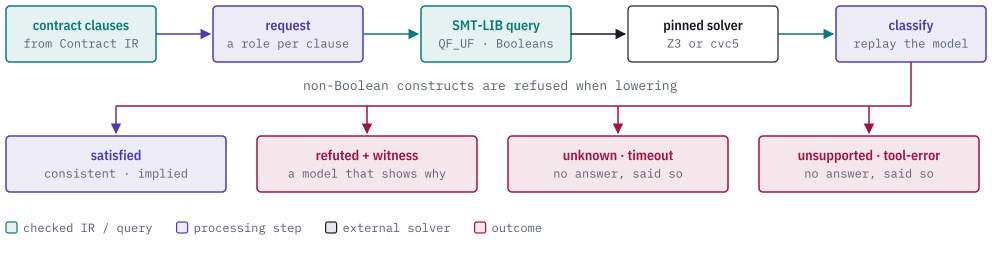
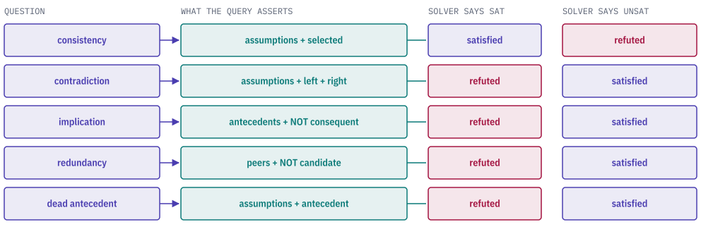
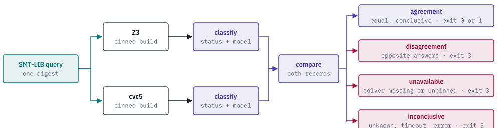

# Quire Analyze

[](https://discord.gg/k8DVhuYBR2)

Quire Analyze is a Rust library and command-line tool that checks requirement
contracts with an SMT solver.

It reads requirement contracts from
[Contract IR](https://github.com/agent-ix/quire-contract-ir), checks whether
they are consistent and whether one implies another, and returns a typed answer.
A conflict comes with a model naming the clauses and values involved, re-checked
before it is reported. Undecided, timed-out and wrong-solver runs are reported
as their own states.

<picture>
  <source media="(prefers-color-scheme: dark)" srcset="docs/images/hero-dark.svg">
  
</picture>

> **Status: public prerelease.** The crate is at 0.1.0, its API is not stable
> and it is not published to any registry. Solver execution is Linux-only; on
> other platforms the library builds and reports `unsupported`. Expect breaking
> changes.

## Analysis kinds

An analysis request names its statements by role. The role decides what is
asserted, and the kind of question decides how a solver reply is read. For
consistency, a `sat` reply means satisfied. For the other four, the query asserts
a negation, so `unsat` means satisfied and `sat` is a counterexample.

<picture>
  <source media="(prefers-color-scheme: dark)" srcset="docs/images/kinds-dark.svg">
  
</picture>

| Constructor on `AnalysisRequest` | Question | Witness model on `sat` |
| --- | --- | --- |
| `consistency` | Can the selected clauses all hold together, given the assumptions? | `Shared`: one assignment satisfying them all |
| `contradiction` | Can the left and right groups hold at once? | `Common`: an assignment where both hold |
| `implication` | Do the antecedents force the consequent? | `Counterexample`: antecedents hold, consequent fails |
| `redundancy` | Do the peers already force the candidate? | `Distinguishing`: peers hold, candidate fails |
| `dead_antecedent` | Can the antecedent ever be true? | `Activation`: an assignment that makes it true |

## Supported constructs

Queries are in SMT-LIB 2.6, logic `QF_UF`, over Boolean variables. Lowering
accepts Boolean literals, value references, `not`, `and`, `or` (both short-circuit
and total forms), implication, and Boolean equality and inequality. Any other
construct is refused when the request is lowered, with a typed error naming it:
integers, rationals, text, enums,
records, options, collections, field access, arithmetic, ordering, quantifiers,
pure function calls and local references. (The authoritative list is
`CAPABILITY_CONTRACT` in [`src/smt.rs`](src/smt.rs).)

Lowering is deterministic. The same clauses in a different order produce the
same query bytes and the same digests, and every assertion in the query carries
a name that maps back to the package, requirement, revision and clause it came
from. A sample is in [`tests/golden/boolean-v1.smt2`](tests/golden/boolean-v1.smt2).

## Outcomes

Every analysis ends in one `AnalysisStatus`. Only `satisfied` and `refuted` are answers.

| Status | Meaning |
| --- | --- |
| `satisfied` | The property holds (consistent, or the implication is valid). |
| `refuted` | The property fails; a verified witness model is attached when the solver produced one. |
| `unknown` | The solver answered `unknown`. |
| `timeout` | The wall-clock limit was reached, or the run was cancelled. |
| `unsupported` | The platform cannot run the solver adapter. |
| `tool-error` | Anything else: missing, changed or wrongly versioned executable, malformed or contradictory output, an exceeded input or output limit, a nonzero exit, a query that does not match the solver record. |

The adapter pins the solver by version string and executable SHA-256, runs it
with fixed arguments and bounded input, output, model and time limits
(`AdapterLimits`), and records its raw stdout, stderr and exit. A model is
verified by parsing it, checking it assigns exactly the declared symbols, and
replaying every assertion against it; if that fails the answer stays
conclusive, the explanation is marked `Incomplete`, and a differential run does
not count it as an agreement.

## Usage

This example is from the test `model_decode_mapping_and_replay_are_fail_closed`
in [`tests/analysis_semantics.rs`](tests/analysis_semantics.rs). The helpers
`statement` and `execute_response` build a clause from a Contract IR package
and run a stand-in solver script; they live in the same test file.

```rust
let request = AnalysisRequest::consistency(
    vec![],
    vec![statement("mapped-model", value("ready"), &["ready"])],
    vec![],
)
.expect("request");
let query = lower_analysis_request(&request).expect("lower");
let symbol = query.variables()[0].symbol.clone();
let valid = execute_response(&query, &model_response(&query, true));
let conclusion = classify_analysis(&query, &valid);
assert_eq!(conclusion.status(), AnalysisStatus::Satisfied);
assert_eq!(conclusion.explanation(), ExplanationState::Verified);
let model = conclusion.verified_model().expect("verified model");
assert_eq!(model.purpose(), ModelPurpose::Shared);
```

To run a real solver, build a `SolverConfig` from the engine, the executable
path, a `SolverPin` (version and SHA-256 of the binary) and `AdapterLimits`,
then call `execute_solver(&query, &config, &CancellationToken::default())`.
The same file shows it in `nonconclusive_adapter_states_remain_nonconclusive`:

```rust
let config = SolverConfig::new(
    SolverEngine::Z3,
    &executable,
    SolverPin::new(VERSION, digest(&executable)),
    AdapterLimits::default(),
)
.expect("config");
let cancelled_record = execute_solver(&query, &config, &cancellation);
let cancelled = classify_analysis(&query, &cancelled_record);
assert_eq!(cancelled.status(), AnalysisStatus::Timeout);
```

## Differential runs

`execute_differential` runs the same query on Z3 and cvc5 and keeps both
records, and compares them.

<picture>
  <source media="(prefers-color-scheme: dark)" srcset="docs/images/differential-dark.svg">
  
</picture>

| Disposition | When |
| --- | --- |
| `agreement` | Both conclusive, same status, and any witness model verified. |
| `disagreement` | Both conclusive, opposite statuses. |
| `unavailable` | A solver is missing, unsupported on this platform, or fails its version or digest pin. |
| `inconclusive` | Anything else, such as `unknown`, a timeout, or an unverified model. |

`render_differential_report` writes the run as a canonical-JSON
`quire.differential-report/v1` document (schema in
[`schemas/`](schemas/differential-report-v1.schema.json)) with a digest over the
whole report, and `validate_report_document` re-derives every digest and the
conclusion from the retained raw evidence. A hand-edited report is refused.
`publish_report_new` writes it atomically and does not overwrite an existing file.

## Command line

The binary has one subcommand. It validates an existing differential report and
publishes a copy to a new path:

```
quire-analyze publish-report --input REPORT.json --output NEW_REPORT.json
```

| Exit | Meaning |
| --- | --- |
| 0 | Agreement, and the agreed status is `satisfied`. |
| 1 | Agreement, and the agreed status is `refuted`. |
| 2 | Bad usage, or the input is not a valid bounded report. |
| 3 | The report is a disagreement, unavailable or inconclusive. |
| 4 | Publication failed; the destination was not overwritten. |

## Hybrid reachability and synthesis

Two further providers, in [`src/hybrid_synthesis.rs`](src/hybrid_synthesis.rs),
return typed non-conclusions. `reach` returns a bounded enclosure, and `replay_hybrid` replays a retained
witness against the exact model and bound. `synthesize` searches a finite
canonical space and returns a candidate that `validate_candidate` must confirm
independently. Both report `incomplete`, `failed` or `refused` when they cannot succeed. Their shared result vocabulary lives in the small
`quire-analyze-method-contract` crate in [`crates/method-contract`](crates/method-contract),
which has no dependency on the rest of Quire.

## Quire ecosystem

Quire Analyze is a backend. It reads the Contract IR that the language layer
produces and answers questions about it. It depends on
[quire-contract-ir](https://github.com/agent-ix/quire-contract-ir) for the
contract model, and its method-outcome crate is shared with quire-verification
(private), which plans which verification technique to use for each requirement.

<picture>
  <source media="(prefers-color-scheme: dark)" srcset="docs/images/ecosystem-dark.svg">
  
</picture>

## Building and testing

Everything runs through `make`; see `make help` for the full list.

| Command | What it does |
| --- | --- |
| `make test` | `cargo test`. Most solver tests use stand-in scripts and run on Linux only. |
| `make lint` | Clippy with warnings denied. |
| `make fmt-check` | Verify formatting. |
| `make spec` | Validate the specification and plan with `quire validate`. |
| `make ci` | Every gate: format, lint, test, license and advisory checks, unsafe-comment audit, spec, MSRV (Rust 1.98.1), rustdoc and the coverage floor. |

One test, `official_z3_cvc5_differential_corpus_agrees`, is ignored by default.
Run it with the real binaries by setting `QUIRE_Z3` and `QUIRE_CVC5` to their
paths and passing `--ignored`.

The specification that drives the crate is under [`spec/`](spec); start at
[`spec/index.md`](spec/index.md).

## Contributing

Every contribution needs a signed CLA ([`CLA.md`](CLA.md)); the bot on your
first pull request walks you through it. Requirements and acceptance criteria
are updated before implementation, the repository's gates must pass, and a
human maintainer reviews and owns release decisions. Agent-assisted
contributions meet the same bar. See [`CONTRIBUTING.md`](CONTRIBUTING.md).

## License

AGPL-3.0-or-later. See [LICENSE](LICENSE).
